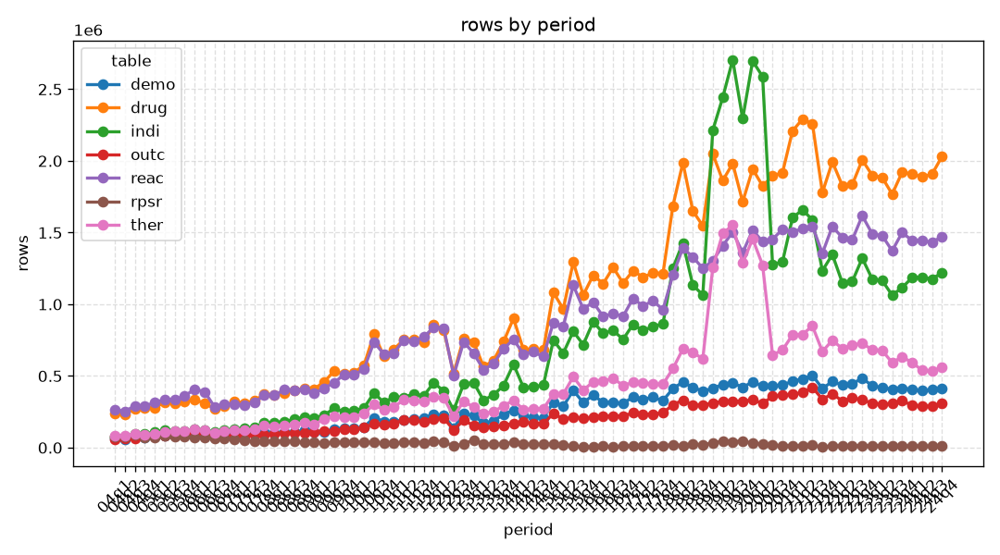
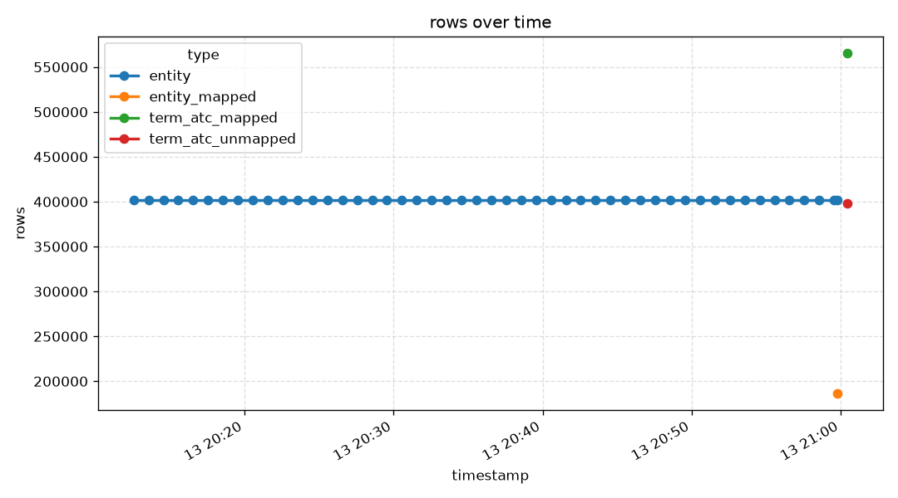

# tgedr-fdafaers

[](https://github.com/jtviegas/fda_faers/actions/workflows/cicd.yml)
[](https://github.com/jtviegas/fda_faers/actions/workflows/fdafiles.yml)
[](https://github.com/jtviegas/fda_faers/actions/workflows/silver.yml)

[](https://pypi.org/project/tgedr-fdafaers/)

## FAERS tables (in HuggingFace)

- [demo](https://huggingface.co/datasets/jtviegas/faers_bronze_demo)
- [drug](https://huggingface.co/datasets/jtviegas/faers_silver_drug)
- [outc](https://huggingface.co/datasets/jtviegas/faers_bronze_outc)
- [indi](https://huggingface.co/datasets/jtviegas/faers_bronze_indi)
- [reac](https://huggingface.co/datasets/jtviegas/faers_bronze_reac)
- [ther](https://huggingface.co/datasets/jtviegas/faers_bronze_ther)
- [rpsr](https://huggingface.co/datasets/jtviegas/faers_bronze_rpsr)


## data pipeline metrics

### rows per period



### mapping rows



## development
- main requirements:
  - _uv_  
  - _bash_
- Clone the repository like this:

  ``` bash
  git clone git@github.com:jtviegas/fda_faers
  ```
- cd into the folder: `cd fda_faers`
- install requirements: `./helper.sh reqs`
